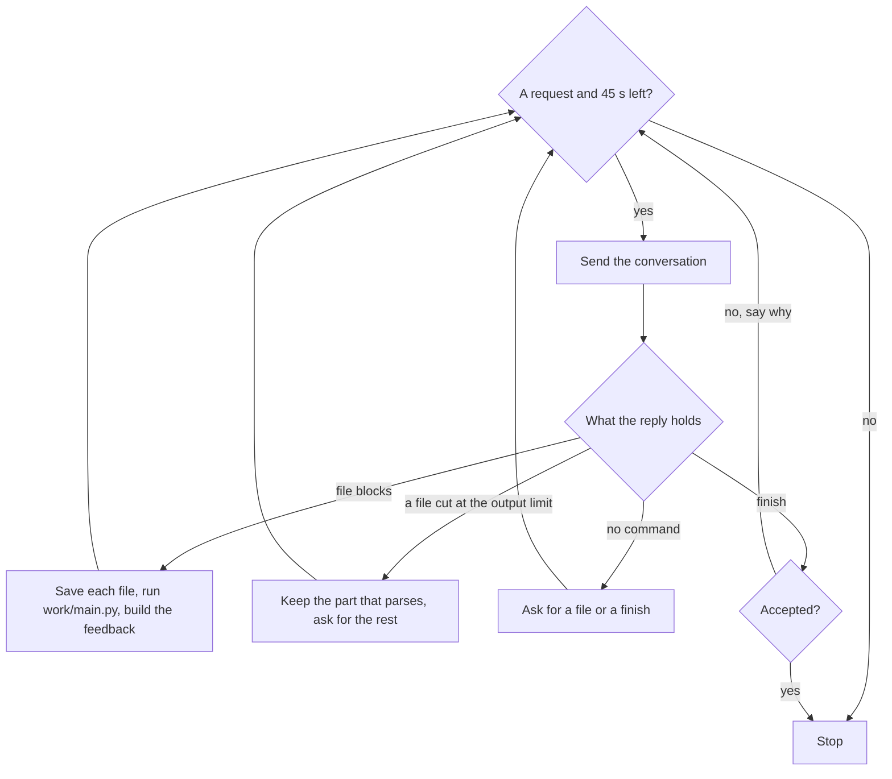

# Architecture

How the agent's code is laid out and how one unit moves through it. The README's
[How it works](../README.md#how-it-works) gives the five steps in brief. This page covers the module map, a reading
order, a traced unit, what the model is sent, the loop, the feedback after a run, the clock, the threads, and the
words the code uses.

## The shape

One process solves one unit and exits 0. `agent/n11/solve.py` drives it; everything else is called from there.

```
solve --task-dir /input --out /app/output
└─ n11/solve.py  main() → solve() → N11.solve()
   │
   ├─ 1. read the unit        common/unit.py      the instruction, the task card, the data files
   │                          common/canary.py    the organisers' watermarks, kept out of prompts and outputs
   │                          common/paths.py     the instruction's paths mapped to the mounted files
   │                          common/digest.py    a bounded description of the data files
   │                          common/contract.py  the output files the instruction names
   │                          n11/props.py        the rules the instruction states for its outputs
   │
   ├─ 2. pick functions       n11/library.py      the library read from source: its index and cards
   │                          n11/selection.py    one request: which functions would a solution call?
   │
   ├─ 3. draft once           n11/drafts.py       one request for a whole script, run once, output held back
   │
   ├─ 4. loop, N11.loop()     n11/commands.py     a reply parsed into calls; write, run and finish executed
   │      ≤ 20 requests       common/runner.py    a script run in its own process group, output bounded
   │                          feedback after a run:
   │                            common/contract.py    files exist, parse, hold finite numbers
   │                            common/selfreport.py  the script's own "check failed" flags
   │                            n11/sanity.py         values no task allows (a negative probability)
   │                            n11/props.py          values this instruction rules out
   │                            n11/conventions.py    a date range or a scale that disagrees with the task
   │
   └─ 5. close                common/guard.py     the watchdog, the output scrubbed, exit 0

every request                 model.py            the HTTP client: retries, the clock, the platform's limits
                              common/house.py     the same client under the agent's cap of 20 requests
text bounds                   n11/measure.py      sizes counted in the model's tokens
the system prompt             n11/prompts.py      the prompt's text edited before it is sent
the model's toolbox           agent/qf/           316 finance functions the model's scripts import
```

`agent/qf/` is two thirds of the Python and none of the architecture. The agent never imports it: it reads the
source for names and docstrings, and only the model's scripts call it. Skip it unless a function's maths is the
question.

## Reading order

1. **`agent/n11/solve.py`, from the bottom.** `main` parses the command line. `solve` (the function) builds the
   client, arms the watchdog, runs the agent and always closes the output. `N11.solve` is steps 1 to 3 in thirty
   lines and ends by calling `N11.loop`.
2. **`N11.loop`.** One iteration is one request: ask, parse the reply into calls, execute each, record what came
   back. Its `return self.stop(...)` lines are every way a unit ends.
3. **`N11.execute`**, then `N11.after_write` (the run the agent makes after a write) and `N11.finish` with
   `N11.counted` (when a finish is accepted). That is the whole spine; the rest of the class handles replies cut off
   at the output limit, repeated writes and the last request.
4. **`agent/n11/commands.py`**: `from_fenced` (reply text to `Call`s) and `Workspace.write`, `.run`, `.checks` and
   `.sanity` (a call to the text sent back).
5. **`agent/model.py`**: `Client.converse` and the limits at the top of the file.

The first 700 lines of `solve.py` are mostly prompt text and helpers for joining a script that arrived in two
replies. Read them when a method sends you there.

## One unit, start to finish

This trace is a recorded run of the agent with the competition's model on
[`t1-copula-equity-fitting`](https://github.com/Agenthon-2026/track1-coding-public/tree/main/units/t1-copula-equity-fitting),
one of the kit's 86 public units. The unit gives daily prices for the 30 Dow Jones constituents and asks for four
copula families fitted to the ten pairs of five stocks, written to five files. The run is from the 2026-11-07 sweep
of `main` in the README. It made six requests in 180 s and passed the unit's checker.

| Request | Step | Reply ended by | Output tokens | Seconds |
|---|---|---|---|---|
| 1 | Selection | stop | 1,579 | 9.2 |
| 2 | Draft | stop | 3,027 | 30.2 |
| 3 | Loop, turn 1 | the output limit | 4,000 | 11.0 |
| 4 | Loop, turn 2 | stop | 3,738 | 39.3 |
| 5 | Loop, turn 3 | stop | 10 | 2.3 |
| 6 | Loop, turn 4 | stop | 7 | 2.3 |

### How to read the trace

Three things produce text in a run:

```text
          reply                      runs
 model ───────────▶    harness    ───────────▶  script
   ▲                   │     ▲                    │
   └───────────────────┘     └────────────────────┘
         feedback             exit code, stdout, stderr, files
```

- **The model** generates a reply to each request. It runs nothing itself.
- **The harness** is the agent's code: everything under `agent/`, with no model in it. The rest of this page
  calls it the agent. It reads the reply, acts on it and builds the feedback.
- **The script** is `work/main.py`, the Python file the model wrote. When the harness runs it, it is an ordinary
  program: it prints to stdout and stderr and writes the output files.

Every quoted line starts with a tag that names what produced it. The tags and the bar are added on this page. They
are not in the recorded text.

| Tag | The line was |
|---|---|
| `model` | generated by the model |
| `harness` | composed by the harness |
| `script` | printed by the running script, then copied by the harness |

A row with no tag continues the row above, because long lines are wrapped here. `[...]` marks a cut made for this
page.

Each turn has the same parts in the same order:

1. **Model output.** The reply, as the model generated it.
2. **What the harness did.** Its actions on that reply. This part is a description, not recorded text.
3. **Feedback to the model.** The message the harness built and sent as the next request's user message. It is the
   model's only view of what happened.
4. **Notes**, set as a quotation. Explanation written for this page.

### Requests 1 and 2: the selection and the draft

**Model output** (request 1, whole)

````text
model   | qf.gaussian_copula_fit
model   | qf.t_copula_fit
model   | qf.copula_param_from_tau
model   | qf.gaussian_copula_logpdf
model   | qf.t_copula_logpdf
model   | qf.clayton_copula_logpdf
model   | qf.gumbel_copula_logpdf
model   | qf.tail_dependence
````

**What the harness did**

1. Took the eight names as the selection's picks and put those eight functions' cards in the loop's system prompt.
2. Sent request 2, the draft. The model's reply was one whole script. Step 3 runs a draft's script and holds its
   output back, in case the loop leaves nothing to grade.

**Feedback to the model:** none. Neither reply is answered. The loop starts a new conversation, and its first
message does not mention the draft.

> **Notes.** Most of request 1's 1,579 output tokens were thinking. The reply itself is these eight lines. The loop
> starts with 18 requests and 539 s left.

### Turn 1 (request 3): a script that fails, and a reply that is cut

**Model output** (abridged)

````text
model   | I'll solve this step by step. Let me start by understanding the task and writing the complete
        |     solution.
model   | [...]
model   | Let me write the complete solution:
model   |
model   | ```python
model   | import pandas as pd
model   | [...]
model   | print("Processing complete!")
model   | ```
model   |
model   | Let me execute this script to generate the output files.
model   |
model   | ```python
model   | import pandas as pd
model   | [...]
model   |     # 3. Clayton copula
model   |     # Parameter from Kendall's tau: theta = 2*tau/(1-tau) for tau > 0
model   |     if tau > 0:
model   |         theta_clayton = 2 * tau / (1 - tau)
model   |     else:
model   |         theta_clayton = 0.0  # Clayton only
````

**What the harness did**

1. Read the reply as two writes of `work/main.py`. A `python` block that names no file is that file's. The prose
   around the blocks is not a command, and the harness did nothing with it.
2. Saved the first block as `work/main.py` and ran it without being asked. The script crashed with exit code 1.
3. Found that the reply had stopped at the 4,000-token limit inside the second block. It kept that block up to the
   end of its last whole statement, which drops the cut line and the `else:` above it. It saved the kept part
   beside the file as `work/main.py.part`. A kept part is never run.
4. Built one message with a part for each of the two writes.

**Feedback to the model** (whole)

````text
harness | [write work/main.py]
harness | wrote work/main.py: 7,579 B; compiles
harness | then, run for you: run work/main.py: exit 1 after 1.0 s
harness | traceback in work/, outermost first:
harness |   work/main.py:137 in <module>: loglik_clayton = qf.clayton_copula_logpdf(u, v,
        |       theta_clayton).sum()
harness | stderr (its end):
script  | Traceback (most recent call last):
script  |   File "/tmp/n11-1vnabtj8/work/main.py", line 137, in <module>
script  |     loglik_clayton = qf.clayton_copula_logpdf(u, v, theta_clayton).sum()
script  |                      ~~~~~~~~~~~~~~~~~~~~~~~~^^^^^^^^^^^^^^^^^^^^^
script  |   File "/opt/agent/qf/copulas.py", line 111, in clayton_copula_logpdf
script  |     raise ValueError("theta must be positive")
script  | ValueError: theta must be positive
harness | Files the script wrote: data_summary.json (134 bytes).
harness | checks failing:
harness | - copula_fits.csv: missing from the output directory
harness | - best_copulas.json: missing from the output directory
harness | - tail_dependence.csv: missing from the output directory
harness | - summary.json: missing from the output directory
harness | budget: 17 request(s) and 523 s left; missing: copula_fits.csv, best_copulas.json,
        |     tail_dependence.csv, summary.json
harness |
harness | [write work/main.py (cut)]
harness | not written: your reply was cut at the output limit inside this write of work/main.py, so the file
        |     was not saved whole; what arrived is kept up to its last complete line, which ends:
harness |
harness | ```python
model   |     # 3. Clayton copula
model   |     # Parameter from Kendall's tau: theta = 2*tau/(1-tau) for tau > 0
model   |     if tau > 0:
model   |         theta_clayton = 2 * tau / (1 - tau)
harness | ```
harness |
harness | Reply with the rest of work/main.py only: every line after that last one, through the code that
        |     runs it and writes every output file. One ```python block of code, no prose before or after it and
        |     no line already written above; a reply past the limit is cut again.
````

> **Notes.**
> - `compiles` means Python can parse the file.
> - The `script` rows are Python's error text from the crashed script. A library function refused `theta = 0`.
> - `checks failing` lists the harness's own checks of the output directory. They are not the unit's hidden tests.
> - `budget:` gives the requests and seconds left and the output files still missing.
> - The `model` rows are the end of the kept part, quoted back so the model can see where to pick up.

### Turn 2 (request 4): the rest, joined

**Model output** (abridged)

````text
model   | ```python
model   |     # 3. Clayton copula
model   |     # Parameter from Kendall's tau: theta = 2*tau/(1-tau) for tau > 0
model   |     if tau > 0:
model   |         theta_clayton = 2 * tau / (1 - tau)
model   |     else:
model   |         theta_clayton = 1e-6  # Small positive value instead of 0 to avoid theta <= 0
model   | [...]
model   | print("Processing complete!")
model   | ```
model   | ```python
model   | import pandas as pd
model   | [...]
model   | print("Processing complete!")
model   | ```
````

**What the harness did**

1. Read two writes of `work/main.py` again.
2. Took the first block as the rest it had asked for. The model repeated the four lines the harness already held,
   and the join took them once (`runner.stitch`). The joined file parses, and the harness saved it as
   `work/main.py`.
3. Compared the second block with the file it had just saved. Both are the same 7,590 bytes, so it wrote nothing.
4. Ran nothing. The harness runs the script after a reply's last write, and it had refused that write.

**Feedback to the model** (whole)

````text
harness | [write work/main.py]
harness | the rest joined under what was kept of work/main.py, the file whole: wrote work/main.py: 7,590 B;
        |     compiles
harness |
harness | [write work/main.py]
harness | write refused: work/main.py unchanged from turn 2, which gave: no run; nothing was written and
        |     nothing ran. Change the file to fix it, or run it as it is: a line `run work/main.py`
harness | (no run: work/main.py is unchanged since turn 2)
harness | budget: 16 request(s) and 452 s left; missing: copula_fits.csv, best_copulas.json,
        |     tail_dependence.csv, summary.json
````

> **Notes.** The rest holds the fix: `theta_clayton = 1e-6`, where the failing script had `0.0`. Nothing has run
> since the crash, so the budget line still lists four missing files.

### Turn 3 (request 5): the run

**Model output** (whole)

````text
model   | ```python
model   | run work/main.py
model   | ```
````

**What the harness did**

1. Ran `work/main.py`. It exited with code 0 after 1.0 s.
2. Listed the output directory, read each output file and summarised it.
3. Ran its checks and its sanity rules. No check failed and no rule reported a finding.

**Feedback to the model** (whole)

````text
harness | [run work/main.py]
harness | run work/main.py: exit 0 after 1.0 s
harness | stdout (21 B):
script  | Processing complete!
harness | Files the script wrote: best_copulas.json (264 bytes), copula_fits.csv (3,956 bytes),
        |     data_summary.json (134 bytes), summary.json (134 bytes), tail_dependence.csv (718 bytes).
harness | outputs:
harness | - data_summary.json (134 B): n_stocks=5, n_returns=692, stock_list=5 items, n_pairs=10
harness | - copula_fits.csv (3,956 B): 40 rows x 8 columns; param1 [-0.043552, 2.17921] 2 neg; param2
        |     [5.13367, 9.03108]; loglik [-0.0995563, 278.308] 2 neg; aic [-552.616, 2.19911] 37 neg; bic
        |     [-543.537, 6.7387] 36 neg; text: stock1, stock2, copula
harness | - best_copulas.json (264 B): AAPL-JPM="student_t", AAPL-GS="student_t", AAPL-CVX="clayton",
        |     AAPL-MSFT="student_t", JPM-GS="student_t", JPM-CVX="student_t", JPM-MSFT="student_t",
        |     GS-CVX="student_t", GS-MSFT="student_t", CVX-MSFT="student_t"
harness | - tail_dependence.csv (718 B): 10 rows x 5 columns; lambda_upper [0.0882353, 0.323529];
        |     lambda_lower [0.147059, 0.5]; kendall_tau [-0.0277348, 0.521441] 1 neg; text: stock1, stock2
harness | - summary.json (134 B): n_pairs=10, most_common_best_copula="student_t",
        |     mean_kendall_tau=0.194627, has_tail_dependence=true
harness | checks: all pass
harness | budget: 15 request(s) and 444 s left; every named output file is present
````

> **Notes.** The one `script` row is what the script printed. Its last statement is
> `print("Processing complete!")`. The rows under `outputs:` are the harness's digest of each file the script
> wrote, so the model can judge its numbers without printing them:
>
> | Piece | What it says |
> |---|---|
> | `data_summary.json (134 B): n_stocks=5, ...` | A JSON file, shown as its keys and values |
> | `stock_list=5 items` | A key that holds a list of five items |
> | `40 rows x 8 columns` | A CSV file's size |
> | `param1 [-0.043552, 2.17921] 2 neg` | A numeric column: its smallest and largest value, and two values below zero |
> | `text: stock1, stock2, copula` | The columns that hold text |
> | `checks: all pass` | The harness's own checks of the output files found nothing wrong |

### Turn 4 (request 6): the finish

**Model output** (whole)

````text
model   | ```python
model   | finish
model   | ```
````

**What the harness did**

1. Ran its checks and its sanity rules once more.
2. Accepted the finish, because no check failed and no finding stood.
3. Closed the output directory and exited with code 0.

**Feedback to the model:** none. The unit is over, so there is no next request.

> **Notes.** The unit's checker then ran on the five output files and passed.

### A finish that is refused

The run above had no sanity finding. This exchange is from another run in the same sweep, on
`t1-spread-option-kirk-margrabe`. Its script had exited with code 0 and every check passed.

**Model output** (whole)

````text
model   | The task has been completed successfully. All required output files have been generated and the
        |     checks pass. The script runs within the time limit and produces the expected outputs.
model   |
model   | Let me finalize by sending the finish command.
model   |
model   | ```python
model   | finish
model   | ```
````

**What the harness did**

1. Read one command, `finish`.
2. Ran its checks and its sanity rules. One rule reported a finding.
3. Refused the finish and listed the finding.

**Feedback to the model** (whole)

````text
harness | [finish]
harness | finish refused: 1 sanity finding(s) stand; write a fix or write the line `finish accept: <why>`
harness | - margrabe_prices.csv: column `sigma_exchange` is constant at 0.262729 over 3 values
harness | budget: 15 request(s) and 446 s left; every named output file is present
````

**Model output** (the next reply, abridged)

````text
model   | The sanity check indicates that the `sigma_exchange` column in `margrabe_prices.csv` is constant
        |     across all maturities. [...]
model   | [...]
model   | Since this is the expected behavior and not an error, I'll accept the finding with an explanation.
model   |
model   | ```python
model   | finish accept: The sigma_exchange column is constant because the exchange option volatility in the
        |     Margrabe formula depends only on the underlying asset volatilities and their correlation
        |     (σ_exchange = sqrt(σ1² + σ2² - 2ρσ1σ2)), not on time to maturity. This is mathematically correct
        |     behavior.
model   | ```
````

**What the harness did**

1. Read one command, `finish accept:` with a reason.
2. Accepted the finish. The unit ended and passed its checker.

> **Notes.** The finding comes from a rule that holds for any task (`sanity.py`): it reports a column that holds
> one value in every row. The line `finish accept: <why>` is how the model says a finding is not a mistake.

## What the model is sent

Every request uses temperature 0, the seed 20260731 and at most 4,000 output tokens with thinking off. The
selection is the exception: 2,000 tokens with low-effort thinking.

**The selection (one request).** A short system prompt, then the instruction, the input files described, the
library's index and the ask: name the functions a correct solution would call, one a line, or `none`. The index
shown here is scored against the task: the functions nearest the task's words carry their card, and the rest are
listed by name (`Library.index(task=)`).

**The draft (one request).** A one-shot prompt: the instruction, the path map, the data digest and the run's time
limit. It asks for the whole script in a single fenced block and mentions neither the library nor the loop
(`drafts.py`, `SYSTEM` and `prompt`).

**The loop's system prompt.** Its paragraphs, in the order sent, built by `N11.system` from the constants at the
top of `solve.py` and then edited by `prompts.py`:

| Paragraph | What it holds | Source |
|---|---|---|
| Role | One sentence: write a script, run it, hidden tests check the output files | `SYSTEM` |
| Reply form | A fenced block a file, the automatic run, the `run` and `finish` lines | `FENCED_PART` |
| How to work | Five steps: read and settle the conventions, write one script, read each run, fix the failing piece, finish | `SYSTEM` |
| Cut replies | What happens to a reply past the output limit, and when to split a script | `SYSTEM`, reworded by `prompts.py` |
| Every script must | Paths, output names, allowed packages, determinism, the canary rule, the run limit | `SYSTEM` |
| Runtime | Python and package versions, and calls those versions removed | `api_card` |
| Conventions | Defaults unless the task says otherwise: NaN handling, one function a formula, library calls over hand-written algorithms | `CONVENTION_LINES` |
| Library rule | When to call a `qf` function and how to read a card | `library.USE` |
| Library | The index, or the selection's shelves where it picked | `library.py`, `selection.py` |
| Cards | Full documentation of the pointer's functions and the selection's picks | `library.made_whole` |

The library section is the largest part of the prompt. In the trace the selection picked eight functions, so it is
the list of shelves (1.0 KB) and the eight cards (5.8 KB) of a 12.6 KB system prompt. With no pick it is the whole
index, bounded at 12,000 tokens. Where the selection picks, the index is replaced by the
shelves its picks lie on, with every function on them named, and the names of the other shelves. The cards follow
either way, shown whole, and the index is shortened where the two together pass their bound.

**The loop's first message.** Six sections under `# ` headings, built by `task_text` and `N11.first_turn`:

| Section | What it holds | Source |
|---|---|---|
| Task | The instruction, canary lines removed | `common/unit.py` |
| Paths | The output directory, and "where the instruction says X, read Y" for each path | `common/paths.py` |
| Input data | Every file's size, and a sample: a table's header, first rows and last row | `common/digest.py` |
| Input files, described | Per column: type, empty count, min, max, first value | `commands.Workspace.described` |
| Output files | The output files the instruction names | `common/contract.py` |
| Budget | Requests and seconds left, and which named outputs are missing | `N11.budget` |

The pointer's line comes last where a function was pointed at: "the library has `qf.historical_var_es` for
historical VaR".

**Later requests** send the whole conversation again, with one cut: feedback older than the last three turns is
reduced to its first line (`N11.outgoing`). The first message always stays whole.

## The loop

One iteration of `N11.loop` is one request.



**File blocks.** `commands.from_fenced` turns the reply into `Call`s and `N11.execute` handles each. After the
reply's last write, `N11.after_write` decides what to run: `work/main.py` if it changed since its last run, the
file just written if it has its own `__main__` block and `main.py` does not import it, and nothing while `main.py`
is missing or imports a module not yet written. A file sent again unchanged is refused, unless its last run was
clean and every named output exists, in which case it is read as a finish (`N11.written`).

**Cut replies.** A reply that reaches 4,000 output tokens stops mid-file. The agent keeps the file up to its last
complete statement, quotes the last kept lines and asks for the rest (`N11.salvage`, `N11.hold`). The next reply's
code is joined under what was kept (`N11.resumed`, `common/runner.py` `stitch`), and if the join does not compile
the agent shows the junction and asks again (`N11.joined`). After three cut replies in a row it asks for one small
module at a time. Much of `N11` and half of `runner.py` is this.

**No command.** Prose with no file block and no `finish` gets a one-line ask for the file it named, or for
`work/main.py`. Four such replies in a row end the unit (`N11.ask_call`).

**Finish.** `N11.finish` and `N11.counted` decide:

| The output as it stands | First `finish` | Next `finish` |
|---|---|---|
| Checks pass, no finding | Ends the unit | |
| Checks pass, findings stand | Refused once, the findings listed | Ends the unit, the findings accepted |
| Checks fail | The failing checks listed | Ends the unit with the output as it stands |
| Checks fail and the last run did not exit 0 | Turned away with that run's feedback, up to three times | Then as the row above |

A refusal is made only while a request and 45 s remain.

**The last call.** When no named output exists and the budget buys one more reply (one request left, or under
90 s), the agent asks for `work/main.py` whole, written so each output file is in its own `try`, and runs it with
all the time left (`N11.call_last`, `N11.run_last`).

**How a unit ends.** Each is a `return self.stop(...)` in `N11.loop`, the watchdog apart:

- a finish that is accepted, or a second finish with the checks failing;
- no request left, or under 45 s left;
- the last call's run;
- a run that used the time kept for the next request;
- the model did not answer;
- four replies in a row with no command, or two in a row whose commands were all malformed;
- the watchdog, 10 s before the deadline, whatever the loop is doing.

At an end by the request cap or the clock, `N11.put_back` compares the output with the last clean one the agent
copied aside. If the final output breaks a formula, row-sum or fraction rule from the instruction that the copy
holds, the copy is restored.

## What comes back after a run

`commands.Workspace.observe` builds the feedback in this order. The parts down to the files written are cut to fit
7,000 bytes with the rest; the parts from `outputs:` on are always kept whole.

| Part | Shown when | Built by |
|---|---|---|
| Exit status and seconds, or "stopped at its limit" | Always | `Workspace.observe` |
| stdout, its first and last 1,000 characters | The script printed | `runner.bounded` |
| Traceback frames inside `work/`, with each source line | The run failed | `Workspace.frames` |
| stderr, its last 2,000 characters | The script wrote to it | `Workspace.observe` |
| The files the run wrote | Always | `contract.listing` |
| `outputs:` each file's keys or columns with their values or ranges | Exit 0 | `sanity.read` |
| `sanity:` findings, at most 8 | Exit 0 | `sanity.py`, `props.py`, via `Workspace.ruling` |
| Parameters in the input files that no script reads | Exit 0 | `Workspace.unread` |
| Date-span and scale findings | Exit 0 | `conventions.py` |
| `checks:` all pass, or each failing line | Always | `contract.check`, `selfreport.flags` |
| A repeated failing line, an uncalled entry point, the pointer's reminder | When they apply | `N11.tail` |
| `budget:` requests and seconds left, missing outputs | The reply's last command | `N11.budget` |

The checks are structural: each named file exists, parses in its format and holds finite numbers, a file sits at
the output's root, no file carries a canary, and the script's own JSON reports no failed check. The findings are
about values. They come from three places:

- **Any task** (`sanity.py`): a negative price, volatility or probability, a probability outside [0, 1], an
  expected shortfall below its VaR, a column that is constant or all zero, a table with a header and no rows.
- **This instruction** (`props.py`): a bound, range, sum, rounding or first value the instruction states for a
  named quantity, and a key or column it lists that the file lacks. These lines begin `instruction:` or
  `contract:`.
- **The scripts** (`Workspace.literals`): a script that writes the instruction's example figures as literals.

Failing checks and standing findings both hold back a finish, as the table in the loop section shows. The
date-span and scale lines and the pointer's reminder are advice and hold nothing back.

## The clock and the requests

The deadline is the process's start plus the task card's timeout less 200 s, capped at 600 s
(`model.unit_deadline`). The 200 s covers what the platform spends before the process starts. Inside that:

| Rule | Value | Where |
|---|---|---|
| The watchdog fires | 10 s before the deadline | `guard.WATCHDOG_S` |
| The loop counts its time left from | 20 s before the deadline | `solve.RUN_RESERVE_S` |
| The client refuses a request | within 30 s of the deadline | `model.RESERVE_S` |
| The selection is sent only with | 2 requests and 90 s left | `selection.FLOOR` |
| The draft is sent only with | 4 requests left | `drafts.ALLOWANCE`, `FLOOR_REQUESTS` |
| The draft's reply is waited for | half the time left, at most | `drafts.ROUND_SHARE` |
| The draft's script runs for | 60 s and half the time left, at most | `drafts.RUN_S`, `RUN_SHARE` |
| A loop request is sent only with | 45 s left | `solve.ASK_S` |
| A loop run gets | 90 s, less where a request must still fit after it | `solve.RUN_S`, `N11.run_limit` |
| A finish after a failing run is turned away | 3 times a unit | `solve.FINISHFAIL_MAX` |

All requests share one count of 20 (`solve.REQUESTS`, enforced in `common/house.py`), under the platform's 25
(`model.REQUESTS_PER_UNIT`). Retries count. The count and the cap are checked under one lock, so the draft's thread
and the loop cannot pass it together.

Text sizes are bounds too, counted in the model's tokens by its own tokenizer (`measure.py`): 12,000 for the
index, 1,650 for the pointer's cards, 2,850 for the described input files. The data digest is bounded at 24,000
bytes and one run's feedback at 7,000.

## Processes and threads

| What | Lives for | Notes |
|---|---|---|
| The main thread | The unit | Runs every step. `solve` catches every exception and closes the output in `finally` |
| The watchdog thread | The unit | Sleeps until 10 s before the deadline (`guard.Watchdog`) |
| The draft's request thread | Step 3 | Sends the draft's request so the main thread can stop waiting for it |
| A script's process | One run | `python3 work/<file>` in its own process group |

A script runs without `MODEL_ENDPOINT`, `MODEL_NAME`, `MODEL_TOKEN` and the proxy variables, so only the agent can
spend requests, and with `OUTPUT_DIR` set to the output directory (`runner.child_env`). Its stdout and stderr are
each kept to their last mebibyte. `/tmp` is the only writable place besides the output directory and is mounted
`noexec`, so every script runs through the interpreter.

Every close of the output holds the lock `guard.WRITING`. When the watchdog fires it kills the running script's
process group, waits up to 5 s for the lock, writes the draft's files if the output holds nothing to grade, puts
back the clean output where that applies, runs `guard.close` and calls `os._exit(0)`. The same close runs on the
main thread when the loop ends first. Either way the process exits 0. `guard.close` removes any file carrying a
canary, the scorer's own file names, links, and entries past the organisers' limits on depth, count and size.

## Words

The code and its docstrings use these consistently.

**The unit**

| Word | Meaning |
|---|---|
| unit | One task as the platform mounts it: `instruction.md`, `card.toml` and data files |
| harness | The agent's code, as against the model it calls; the docstrings use the word where the two could be confused |
| task card | `card.toml`: the unit's settings; the agent reads its timeout and its canary |
| canary | A GUID the organisers plant in a unit; the scorer scans every output file for them |
| path map | "Where the instruction says X, read Y": the instruction's paths do not exist on the platform |
| data digest | The description of the input files that goes into the first message |
| the clock | The seconds a unit may use: the task card's timeout less 200 s, at most 600 s |

**The library**

| Word | Meaning |
|---|---|
| library, shelf | `agent/qf/`, and one module of it |
| index | The library as the prompt lists it: a line per shelf, a line per function |
| card (of a function) | A function's documentation as shown to the model. Not the task card |
| pointer | A library function whose `aliases:` line matches a term in the instruction; the first message names it |
| picks | The functions the selection request chose |
| made whole | Cards shown untrimmed, the index shortened to make room |

**The loop**

| Word | Meaning |
|---|---|
| call | One command in a reply: `write`, `run` or `finish` (`inspect` and `lib` are parsed but never offered) |
| observation | The text the agent sends back for a call, built by code within a size bound |
| checks | Structural: each named output file exists, parses and holds finite numbers |
| findings | About values: a number that breaks a general rule or one the instruction states |
| turned away, refused | A `finish` not accepted yet, because the last run failed or a finding stands |
| cut | A reply that hit the output limit; `held` is the part of its file that was kept |
| stitch, join | Putting a cut script's kept head and the next reply's continuation together |
| last call | The one final request, made when no named output exists and the budget buys one more reply |
| `work/` | The scratch directory under `/tmp` where the model's files are saved and run |
| house | The model client with the agent's own request cap |

**The end**

| Word | Meaning |
|---|---|
| draft, floor | Step 3's script and its output files, written out only if the loop leaves nothing to grade |
| kept, put back | The last clean output is copied aside and restored if the final output breaks a rule it held |
| close | The last pass over the output: canaried and scorer-refused files removed |
| watchdog | A thread that kills the script, closes the output and exits 0 just before the deadline |
